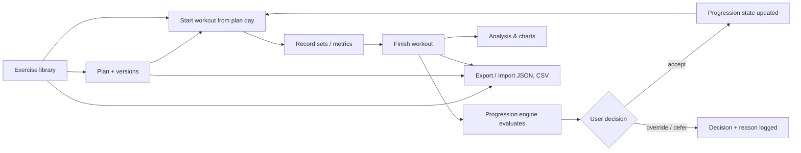
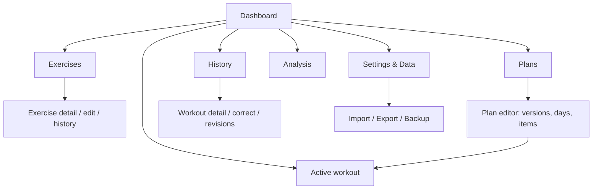
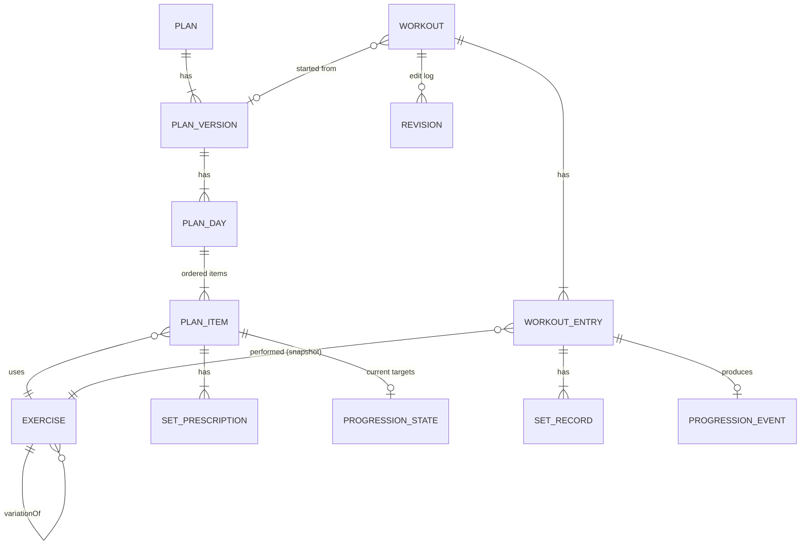
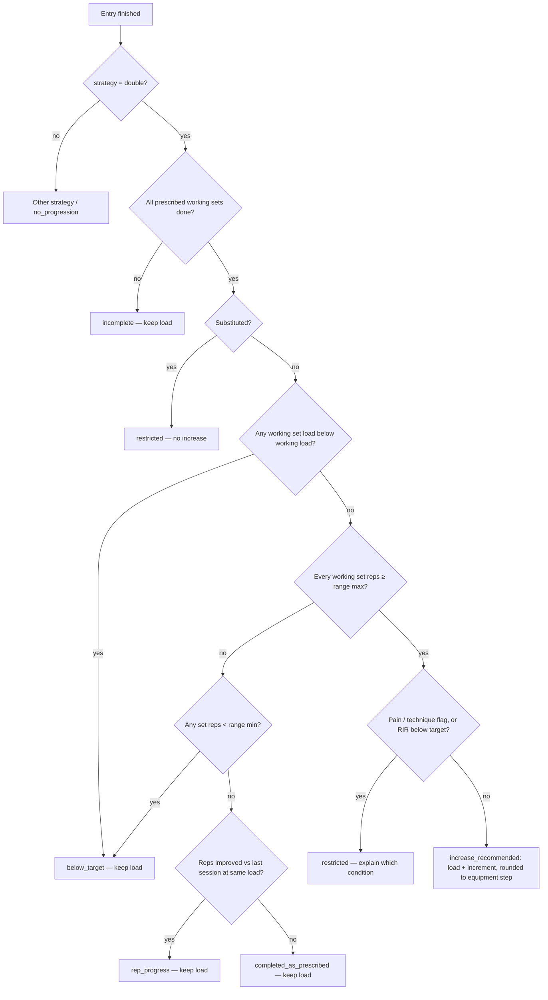
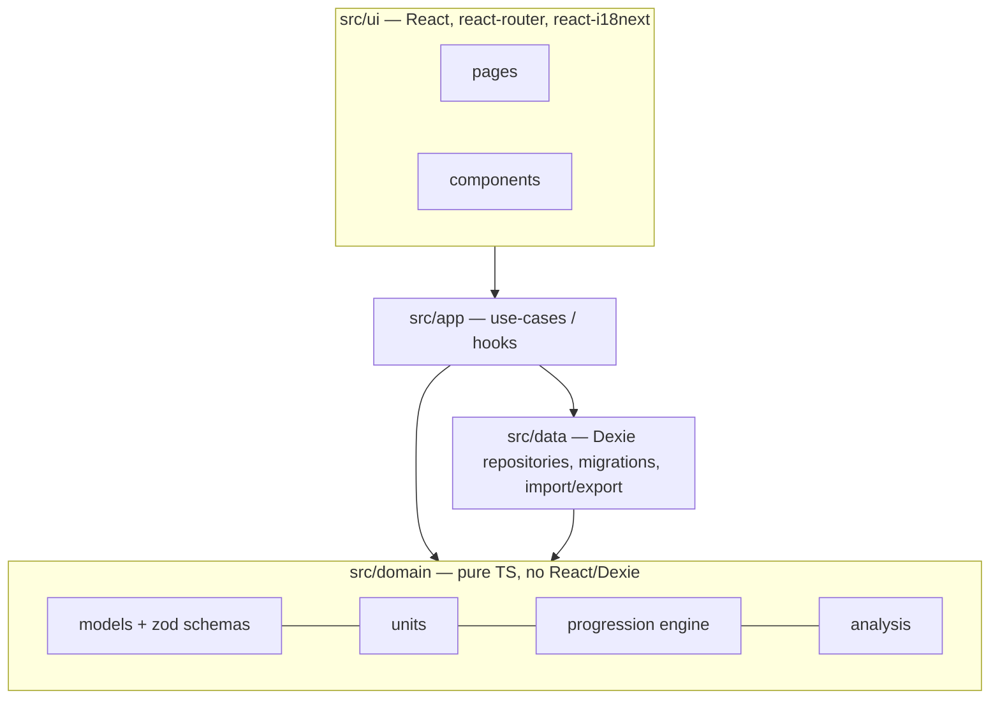

# MyGymProgression — Requirements and Implementation Plan (Phase 1–2)

Status: **Approved 2026-10-29** (recommended defaults accepted).
Source requirements: [`context.md`](../context.md).

---

## 1. Confirmed decisions

| # | Decision | Date |
|---|---|---|
| D1 | Single user, **local-only** storage in the browser (IndexedDB). No server, no accounts. Portability through JSON backup/import. | 2026-10-29 |
| D2 | Stack: **React + TypeScript PWA** (Vite). Android later via **Capacitor**, with a separate gym-optimised mobile UI that reuses the domain and storage code. | 2026-10-29 |
| D3 | UI is **bilingual (PT-PT and EN)** through i18n. | 2026-10-29 |
| D4 | MVP includes the **offline-capable installable PWA** and the **estimated 1RM** feature. | 2026-10-29 |
| D5 | Rest timer, body measurements, cloud sync, reminders, sharing, wearables and AI analysis are **excluded** from the MVP (backlog). | 2026-10-29 |
| D6 | Plan approved with recommended defaults. Q1: seed ~40 common exercises (optional, from Settings and first-run). Q2: progression per plan item. Q3: missing RIR does not block. Q4: stalled after 3 sessions (configurable). | 2026-10-29 |
| D7 | RIR and RPE removed from the app (records, plans, rules). Data schema v2 with automatic migration. | 2026-10-29 |
| D8 | Progression rule: all sets reach the target (double: top of range) → the target goes up **automatically** (undo available). Within the range or sets skipped → keep, no question. A completed set below the minimum (missed reps) → the app asks: keep, or step back one increment. Pain/technique/substitution block an increase. | 2026-10-29 |
| D9 | Each set shows today's goal: last time + 1 rep at the same load (up to the range max); after a load change, the range minimum. | 2026-10-29 |
| D10 | UI redesign: follows system light/dark, large numbers; 4 tabs (Home · Train · History · More); workout shows one exercise at a time with one-tap "Set done"; focused Home; simple plan editor (advanced options folded); analysis per exercise. | 2026-10-29 |
| D11 | Progression depends on the **plan goal** (for exercises with reps and load). Hypertrophy: at the top of the range the user chooses ⬆ load (back to the plan's range) or ⬆ reps (range +1, same load). Strength: the load goes up automatically; mode chosen in the plan: fixed reps (5×5) or low range (4×4–6). Mixed/Other: the exercise's own rule. New exercises in a plan get the goal's default sets; changing the goal offers to re-apply them (loads kept). Schema v3 (additive). | 2026-10-29 |
| D12 | Corrections recreate undecided progression decisions; decided ones are kept. Home shows a pending decision once. | 2026-10-29 |
| D13 | Rest times removed (prescriptions, records, editor, CSV); a rest timer is out of scope. Schema v5 / database v3 strip old rest fields. | 2026-10-29 |
| D14 | Code review fixes: substitution respects its "block" setting; manual target edits keep a reps-up range; "last time" ignores substituted sessions; undo only while the change is still current; deleting a workout undoes its still-current progression changes. Adherence shown again in Analysis. | 2026-10-29 |
| D15 | Design system: one exercise item (image + name + detail) everywhere an exercise appears; one status label (⬆ Sobe, ＝ Mantém, ⬇ Desce, ! Decidir, ✓ Cumprido); full-width rows with › instead of underlined links; secondary actions in ⋯ menus; edit forms as aligned tables with headers once. Built-in exercises get images from their library equivalent. | 2026-10-29 |
| D16 | UI "athletic dark": dark by default (Settings: dark, light or system), large numbers, Home with week strip and monthly stats; long sections collapse (state kept per device). Version shown on a splash screen and an About page; `package.json` is the single source and `npm run deploy:pages` raises the patch version. | 2026-10-30 |
| D17 | Colours: fixed palette of 10 (white text ≥ 4.5:1 on each). A day uses its own colour, else the plan colour; used on Home, Train, History, plan editor and the workout. Plan editor lists exercises collapsed (one open at a time) with a day summary. | 2026-10-30 |
| D18 | Circuits: exercises of a day done back to back for N rounds, without rest. In the plan they are one block (one working set per round per exercise); in the workout the whole circuit is one step with one "Circuit done" at the end. Progression stays per exercise. The free-text superset label is no longer edited. | 2026-10-30 |
| D19 | Join duplicate exercises: plans (exercise and substitutes), workouts, corrections, progression events and states move to the kept exercise in one transaction; the duplicate's names become aliases, empty library fields are filled from it, and it is deleted. Logged snapshots keep the old name. | 2026-10-30 |
| D20 | Personal trainer (optional, off by default): one message when a workout starts. Styles: support, spite ("f*ck you motivation", swear words optional), stoic, sergeant + data (real numbers). Same workout, same message. | 2026-10-30 |
| D21 | Interchange schema v7: additive (colours, circuits, theme, trainer settings). | 2026-10-30 |
| D22 | Strength mode (fixed 5×5 / range 4×4–6) removed: same rule, only the starting sets differed. Strength starts at 5×5; a rep range is set per exercise. Old `strengthMode` values are kept but ignored. Main buttons and highlights use the day colour, else the plan colour, else the default. | 2026-10-30 |
| D23 | Personal trainer setting "when": start only, after every exercise/circuit, or randomly (about 4 in 10, stable per step). Messages after a step show as a short notice. Schema v8 (additive `coach.when`). | 2026-10-30 |
| D24 | Analysis: full-width period control with the dates, and a workouts-per-week bar chart (blocks in plan/day colour; tap a week to list it). | 2026-10-30 |
| D25 | During a workout the screen stays on (Wake Lock API) and a done set or circuit gives a short vibration (where supported). | 2026-10-30 |
| D26 | Backup without a server: on a phone the full backup opens the share menu (Drive, email, chat); elsewhere it is downloaded. Home shows a warning with "Save backup" when there is no backup, or the last one is more than 7 days old. No Google Drive sign-in. | 2026-10-30 |
| D27 | Workout summary shows new personal records against earlier workouts: heaviest set, estimated 1RM (only when the heaviest set is not also a record), most reps (exercises without load), longest set, distance. The first session of an exercise sets no record. | 2026-10-30 |
| D28 | Analysis: sets per muscle **per week** (total ÷ days × 7), with 10–20 as a dashed guideline band (common hypertrophy guideline, not a rule). Totals and muscles compare with the previous period of the same length (not for "All", only when it has workouts). | 2026-10-30 |
| D29 | Share a plan: as a file (import in Settings → Import) or as a link `#/share?d=<deflate+base64url>`. The share is a copy with new ids (always added as a new plan), with the exercises it uses and target loads; never workouts, progress or personal notes. The link leaves out library text and images. Existing exercises are reused (same id, or same name and equipment). | 2026-10-30 |
| D30 | Open exercise library: free-exercise-db (The Unlicense, public domain), built by `scripts/import_free_exercise_db.py` into `public/library/free-exercise-db.json` (thumbnails embedded, ~2.8 MB), published with the app and downloaded only when the user taps "Install open library". Built-in exercises map to it (`BUILTIN_OPEN_SLUG`) for images. The Exsercise.com path stays. | 2026-10-30 |
| D32 | Settings page: cards with action rows (icon, title, description); backup status, full backup and restore together; other exports folded; switches for on/off; danger zone. | 2026-10-30 |
| D33 | Pause: a labelled "Pause" button (top of the workout) and a menu item; the workout stays in progress ("Paused"). Resume: only the most recent workout, when paused or interrupted (History banner, summary). Resuming an interrupted workout undoes its still-current progression changes, keeps a revision, and turns skipped sets back to pending; finishing evaluates it again. | 2026-10-30 |
| D34 | Correcting a workout can change its status (completed, partial, interrupted); exercises and sets not done are highlighted. | 2026-10-30 |
| D35 | Personal trainer outside the workout (setting "Also speak outside the workout", on by default): a greeting for the time of day on Home, and comments on the summary of the latest workout, Analysis and History, in the trainer's style and with real numbers. Once per page per day (once per workout on the summary). Schema v9 (additive `coach.pages`). | 2026-10-30 |
| D36 | **Load sync between plans** (same exercise, active plans, hypertrophy or strength goal). When a load goes up (automatic, ⬆ load, ⬆ reps, or a higher value set by hand), the app asks once per other item: update to X / other value / not now. X: hypertrophy → strength = estimated 1RM of the last session (Epley) converted to the strength reps minimum, or hypertrophy + 1 increment; strength → hypertrophy = 1RM converted to the range minimum, or hypertrophy + 1 increment; same goal (hypertrophy → hypertrophy, strength → strength) = same load with the same range, else 1RM. Rounded down to the increment; never lower. Settings: when (below the suggestion — default; hypertrophy ≥ strength; off) and method (1RM — default; +1 increment). Answers never ask further (no chain); undoing or deleting the source removes its open questions; training the target closes them as kept (D12). A new item in a plan starts from the most recently trained other item. Schema v12 (additive). | 2026-11-01 |
| D37 | **Personal trainer page** (More → Personal trainer): the trainer settings leave Settings (Settings links to it). On/off, style, gender, swear words, when, outside the workout, and the extras D45–D49 (each off by default; voice only where the device can speak). Week reports listed there. | 2026-11-01 |
| D38 | **Automatic warm-up** (Settings → Workout, off by default): at workout start, warm-up sets 50 %×8, 70 %×5, 85 %×3 of the working load (rounded down to the load increment, no repeats, nothing at 0) before the first compound exercise with load and reps of each main muscle, outside circuits. Warm-up sets never count for progression or analysis. | 2026-11-01 |
| D39 | **Setup note**: the exercise's personal notes, shown (📌) and edited in the workout; saved in the exercise. No schema change. | 2026-11-01 |
| D40 | **Short on time** (chip before the first set, and in ⋯): removes optional exercises not started and one pending working set from each exercise with 3 or more working sets (not circuits). Those entries are `short`: the increase is blocked (reason `short`); missed reps still ask. The workout stays "completed". | 2026-11-01 |
| D41 | **Do it later** (⋯): moves the current exercise or circuit to the end of the workout. | 2026-11-01 |
| D42 | **Goals**: target load per exercise (kg total), optional date. Met when a done working set reaches it. Projection: least-squares line through the best estimated 1RM of the sessions of the last 8 weeks (≥ 3); the goal converts to an estimated 1RM at the reps of the latest top set; no projection when flat/down or > 2 years. In Analysis (all) and on the exercise page. Dexie v5 table `goals`. | 2026-11-01 |
| D43 | **Consistency map** in Analysis: last 53 weeks, one square per day in the plan/day colour (outlined when 2+ workouts); weeks in a row (this week counts once it has a workout) and the best run. | 2026-11-01 |
| D44 | **Share image** on the workout summary: a PNG (canvas, 1080×1350) with day, date, stats, up to 6 exercises, records and, with the trainer on, its face and a message. Share menu on a phone, download elsewhere. Nothing is uploaded by the app. | 2026-11-01 |
| D45 | Trainer **live reaction**: a set marked done that beats the same working set of last time (more load with at least the range minimum, more reps at the same load, or a longer set) shows a short message in the trainer's style; it replaces the "after exercise" message. | 2026-11-01 |
| D46 | Trainer **week report** on Sunday: made or refreshed when Home opens on a Sunday (Monday–Sunday: workouts, sets, heaviest set, increases, least trained main muscle among those trained in the 4 weeks before, challenge done/open); closable until the next week; kept (Dexie v5 table `coachReports`, one per week) and listed on the trainer page. | 2026-11-01 |
| D47 | Trainer **voice**: the device speech synthesis (pt-PT / en-GB) reads the start message (before the first set), messages after steps, live reactions and tips, during the workout. | 2026-11-01 |
| D48 | Trainer **tips**: one tip of the exercise library (`tips`) when an exercise opens, stable per workout and entry. | 2026-11-01 |
| D49 | Trainer **rival** on the summary of the latest workout: the finished workout of the same plan day nearest to 90 days before (75–105), else the oldest ≥ 28 days before; per exercise in both, top set (else reps, longest set, distance): won / tie / lost, with a comment. Schema v13 (additive: goals, reports, `short`, `warmup`, trainer extras). | 2026-11-01 |
| D31 | Workout and plan editor components moved to their own files (`EntryFocus`, `CircuitFocus`, `CorrectionEditor`, `CoachCard`, `PlanItemCard`); no change in behaviour. | 2026-10-30 |

## 2. Assumptions (reversible defaults — correct me if wrong)

- A1. Default unit is **kg** and the default load mode is **total load**. Both can be changed in Settings. Lb and per-side loads are supported for each exercise.
- A2. ~~The app only recommends progression.~~ Superseded by D8: increases are applied automatically and can be undone.
- A3. Edits to completed workouts are allowed. Each edit is kept in a **revision log**.
- A4. Media are stored as **URLs only** (image/video links). The app does not upload files in the MVP, so backups stay small.
- A5. Progression state is tracked **per plan item**. The same exercise can have different rep ranges in different plans. See open question Q2.
- A6. "Next workout" is the next training day in the plan sequence after the last completed day. A weekday is optional.

## 3. Open questions (needed before or during M2–M4)

- Q1. **Seed library:** start with an empty library, or include about 40 common exercises (PT/EN names, muscles, equipment)?
- Q2. **Progression scope:** per plan item (recommended, A5) or one global state per exercise?
- Q3. **Double-progression strictness:** if a set has a target RIR and the user does not record RIR, should the set (a) count as eligible (recommended) or (b) block the load increase?
- Q4. **Stagnation threshold:** flag a progression-enabled exercise as stalled after **3** sessions without rep or target progress at the same prescription? (Default 3, configurable.)

---

## 4. Users and main workflows

The user is one person who trains for hypertrophy and/or strength and also does cardio, warm-up and mobility work. During a session the user logs on a phone. The user plans and analyses on desktop or phone.

### Prioritised user stories (MVP = Must)

| Priority | Story |
|---|---|
| Must | Create, edit, search, filter, deactivate and duplicate (as a variation) exercises. |
| Must | Configure the measurement metrics, units and progression strategy of each exercise. |
| Must | Create, duplicate, edit, archive and delete plans with ordered days, exercises, supersets and set prescriptions. |
| Must | Start a workout from a plan day, change it for that session only, and record each set. |
| Must | Record substitutions, skipped sets, pain/technique flags, RIR/RPE and notes. |
| Must | See a progression recommendation with its reasons after each exercise or workout. Accept, override (with a reason) or defer it. |
| Must | View exercise history, trends suited to the metric type, PRs, volume, e1RM, adherence and completion rates. |
| Must | Export and import a full backup (JSON) with preview, validation and conflict resolution. Export sets and workouts as CSV. |
| Must | Use the app offline and install it on a phone (PWA). Switch between PT and EN. |
| Should | Dashboard with the next planned workout and recent progress. |
| Should | Filter the analysis by date range, exercise, plan, goal and muscle group. Compare two periods. |
| Could | Partial export (library only, plans only). |

## 5. Navigation

The active-workout screen is mobile-first: one exercise card at a time, the prescription next to the actual input fields, large number steppers, and "copy previous set" with one tap.

---

## 6. Data model

There are three separate layers: **definition** (Exercise), **prescription** (PlanVersion → PlanItem) and **actual record** (Workout → Entry → Set). Each workout stores a **snapshot** of the exercise metrics and of the prescription. Later edits therefore do not change the meaning of history.

Key entities (abbreviated):

- **Exercise**: `id, name, aliases[], primaryMuscles[], secondaryMuscles[], equipment, category (compound|isolation|cardio|warmup|mobility|other), instructions, safetyNotes, personalNotes, tags[], links[], active, variationOf?, metrics: MetricDef[], loadMode (total|perSide), defaultPrescription, progression: ProgressionConfig, createdAt, updatedAt`.
- **MetricDef**: `key (reps|load|duration|distance|speed|incline|resistance|calories|custom:<name>), unit, required, min?, max?, step?`. **Measurement-type presets** fill these fields: reps+load, bodyweight reps (+ optional added load), duration, distance, duration+distance, speed+incline (+ duration/distance), resistance, time+reps, custom.
- **ProgressionConfig**: `strategy (double|duration|distance|intensity|multi|manual|none), eligibleVariables[], increments {metric: value}, caps?, criteria {requireAllSets, requireRirAtLeast?, blockOnPain, blockOnTechnique, blockOnSubstitution}`.
- **Plan**: `id, name, description, goal (hypertrophy|strength|mixed|other), phase?, status (active|archived), currentVersionId`.
- **PlanVersion** (immutable after a workout uses it; editing such a version creates a new version): `id, planId, number, createdAt, days[]`.
- **PlanItem**: `id, lineageId (stable across versions), exerciseId, order, groupId? (superset), role (warmup|main|optional), sets: SetPrescription[], progression override?, substitutes[], notes`.
- **SetPrescription**: `kind (warmup|working|backoff), targets {metric: {min?, max?, value?}}, rir?, rpe?, restSec?`.
- **ProgressionState**: keyed by `lineageId`. Holds the current working targets (for example `load = 42.5 kg`, `duration = 600 s`). The plan defines the rules and the start values. The state holds the current values, so a load increase does not create a new plan version.
- **Workout**: `id, startedAt, endedAt?, planId?, planVersionId?, dayId?, status (planned|in_progress|completed|partial|interrupted), notes, entries[]`.
- **WorkoutEntry**: `id, exerciseId, exerciseSnapshot, planItemLineageId?, prescriptionSnapshot, substitutedForExerciseId?, order, groupId?, sets[], pain?, techniqueIssue?, notes`.
- **SetRecord**: `id, kind, values {metric: number}, unitsSnapshot, rir?, rpe?, restSec?, status (done|skipped), notes`.
- **ProgressionEvent**: `id, workoutId, entryId, lineageId, strategy, outcome, recommendation?, reasons[], decision (accepted|overridden|deferred|n/a), decisionReason?, before, after, decidedAt`.
- **Revision**: `id, workoutId, at, changedFields, previousValue` (correction history).

Internal storage uses **canonical units** (kg, seconds, metres, km/h, %). The original unit is kept in each record, so the app can display and export values in the recorded unit without loss.

---

## 7. Progression engine

The engine is a pure TypeScript module: `evaluate(prescription, config, state, entry, previousEntries) → { outcome, recommendation?, reasons[] }`. It has no UI or database dependency and has full unit tests.

### 7.1 Outcomes (context §6.5)

`completed_as_prescribed`, `rep_progress`, `increase_recommended`, `increased` (after confirmation), `below_target`, `incomplete`, `restricted` (technique/effort/pain), `manual_adjustment`, `no_progression`.

### 7.2 Double-progression decision order

Rules and edge cases:

- Only **working** sets are evaluated. Warm-up and back-off sets are recorded and are not evaluated.
- Extra sets above the prescription do not block eligibility.
- If a new plan version changes the rep range, the next evaluation uses the new range.
- The increment and rounding use the exercise's unit and load mode (per-side or total).
- Missed sessions never cause an increase. Progression depends only on completed performance.
- After the user accepts, the next prescription shows the new load. The goal is to build reps again from the lower end of the range.

### 7.3 Other strategies

- **Duration / distance / intensity**: every working set reaches the target value of the eligible variable → recommend target + increment, up to an optional cap.
- **Multi-variable**: an ordered list of variables, each with an increment and a cap. The engine progresses the first variable until it reaches its cap, then the next variable. The UI shows which variable progresses.
- **Manual**: no recommendation. Changes to targets and the reasons for them are logged.
- **None**: completion is evaluated (`completed_as_prescribed` or `incomplete` or `below_target`). There is **never** a recommendation and the exercise is **never** flagged as stalled.

---

## 8. Analysis (formulas documented in-app)

| Metric | Applies to | Definition |
|---|---|---|
| Working-set volume | reps+load | Σ(load × reps) over working sets. It is not computed for duration or distance exercises. |
| e1RM (estimate) | reps+load, reps ≤ 12 | Epley: `load × (1 + reps/30)`. Always labelled "estimated". |
| PRs | per metric | Max load at ≥ N reps, max reps at a load, longest duration, longest distance, best pace. |
| Cardio trends | duration/distance/speed/incline | Per-session values and pace = duration / distance. |
| Completion rate | all, mainly fixed exercises | Completed prescribed sets / prescribed sets. |
| Adherence | plans | Completed workouts / planned workouts in a period. |
| Stagnation | progression-enabled only | No rep or target progress over Q4 sessions at the same prescription. |
| Muscle distribution | all | Working sets per primary muscle (secondary muscle = 0.5, documented). |

Filters: date range, exercise, plan, goal, muscle group. Period-over-period comparison. Charts label actual, derived and estimated values differently.

---

## 9. Persistence, backup, import/export

- **Dexie (IndexedDB)** with versioned schema migrations. On first start the app calls `navigator.storage.persist()` to request persistent storage. The app shows a "last backup" reminder.
- **Interchange format** (documented in `docs/data-format.md` with a JSON Schema):
  `{ format: "mygymprogression", schemaVersion: 1, exportedAt, app: {version}, data: { exercises, plans, planVersions, progressionStates, workouts, progressionEvents, revisions, settings } }`
- **Import flow**:
  1. Parse the file.
  2. Validate it with zod and show errors with JSON paths.
  3. Migrate older schema versions.
  4. Show a preview diff: new, identical or conflicting records.
  5. Choose a mode. **Merge** resolves each conflict by skip, overwrite or keep both. **Replace** creates an automatic backup first and needs explicit confirmation.
  6. Commit in a single transaction.
- Duplicate detection uses the `id` first. For exercises without a matching id, it also checks the normalised name and equipment.
- **CSV export**: `workouts.csv`, `sets.csv` (one row per set, one column per metric, with units) and `progression_events.csv`.
- Partial export: library only, or plans only.

## 10. Architecture

| Concern | Choice | Reason |
|---|---|---|
| Build | Vite + TypeScript (strict) | Fast and simple. Capacitor-compatible. |
| UI | React 19, React Router | Common and well supported. Reusable in Capacitor. |
| Storage | Dexie 4 | Typed IndexedDB, migrations, transactions. |
| Validation | zod | One schema set for forms, import and tests. |
| i18n | i18next + react-i18next | PT-PT and EN, with interpolation and plurals. |
| Charts | Recharts | Declarative and sufficient for the MVP. |
| PWA | vite-plugin-pwa | Offline cache and install manifest. |
| Styling | Plain CSS + CSS variables (light/dark) | No extra framework. |
| Tests | Vitest (unit/integration, fake-indexeddb), Playwright (E2E on desktop and mobile viewport) | |

Android path (Phase 5): the same `domain` and `data` layers run inside a Capacitor shell, with a new mobile workout UI. Data compatibility is guaranteed because both apps use the same JSON format. A move from IndexedDB to SQLite would happen only if needed.

## 11. Security and privacy

- No network calls. The app sends no telemetry and has no external fonts or CDNs at runtime. All data stays on the device.
- Backup files contain health-related data. The UI warns the user to store them safely. Backup encryption is a backlog item.
- External links open with `rel="noopener noreferrer"`. User text is rendered as text, never as HTML.
- Import is never trusted: the app validates it strictly and limits its size.

## 12. Testing and acceptance

- **Unit tests (domain):** context examples §6.3 and §6.4 as table tests; boundary reps (min, max, max−1); missing sets; skipped sets; extra sets; substitutions; pain/RIR restrictions; range change between versions; kg/lb and per-side rounding; treadmill warm-up with `none` (never recommended, never stalled); treadmill with duration progression; plank; multi-variable caps; e1RM; volume excluded for cardio.
- **Integration tests (data):** migrations; import/export round-trip equality; invalid files; conflict modes; replace with automatic backup; plan edit → new version → old workout unchanged.
- **E2E (Playwright, desktop + Pixel viewport):** the Phase 4 demonstration list (create exercise → plan → log workout → recommendation → accept → history/analysis → export → import into empty DB).
- Acceptance = all 17 criteria in context §12, each mapped to at least one automated test (traceability table in `docs/acceptance.md`).

## 13. Milestones

| M | Content | Depends on |
|---|---|---|
| M0 | Scaffold, git init, lint/format/test tooling, i18n skeleton, docs skeleton | — |
| M1 | Domain models, units, zod schemas, **progression engine + tests** | M0 |
| M2 | Dexie persistence + migrations; **exercise library** UI (CRUD, search, filter, variations, measurement presets) | M1 |
| M3 | **Plans**: CRUD, versions, days, items, supersets, duplicate/archive, progression state | M2 |
| M4 | **Workout logging**: start from plan, session edits, per-metric set entry, substitutions, statuses, recommendations and decisions, corrections with revision log | M3 |
| M5 | **History, analysis, dashboard**, e1RM, filters, charts | M4 |
| M6 | **Import/export** JSON + CSV, preview, conflicts, migrations, data-format docs | M2 (can run in parallel with M5) |
| M7 | PWA offline/install, accessibility pass, E2E suite, demo data, README → **Phase 4 demo** | M5, M6 |

At the end of each milestone I will report the changes, the test results and the limitations, and make a git commit.

## 14. Risks and mitigations

| Risk | Mitigation |
|---|---|
| Browser storage eviction or loss | `storage.persist()`, backup reminder, easy export |
| The flexible metric model becomes vague | A fixed set of metric keys, each with a unit, a validation rule and presets; custom metrics also need a unit |
| Plan edits corrupt the meaning of history | Immutable used plan versions + snapshots in workouts |
| Progression rules are wrong or surprising | Pure engine with table tests; every recommendation shows its reasons; the user always confirms |
| Scope growth | MVP and backlog kept separate; decision log in this file |
| Android UX later needs a different structure | The domain and data layers are UI-independent now |

## 15. Backlog (not in MVP)

~~Rest timer~~ (excluded, D13) · body measurements and photos · cloud sync/accounts · reminders · ~~template sharing~~ (done as plan sharing, D29) · wearables · fatigue/plateau modelling · AI analysis · encrypted backups · local image upload.

## 16. Decision log

See §1. New decisions are added there with a date.
