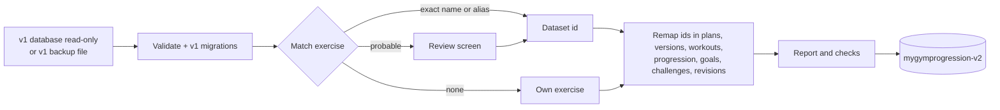

# MyGymProgression v2 — Plan

Status: **F0–F5 done; F6 PT-PT instructions done. Left: user acceptance, then version 2.0.0 with its "What's new" entry, final checks and publish on the same URL.** Branch `v2`. Started 2026-11-22.

Goal: a more professional app. New design, clearer organisation (shortcut icons, complete menus), features compared with openGym, exercise library from [exercises-dataset](https://github.com/hasaneyldrm/exercises-dataset), and all v1 data migrated without loss. **v1 is kept and can come back at any time.**

## 1. Decisions

| # | Decision | Date |
|---|---|---|
| V2-D1 | Same repository and same URL. v1 is frozen on branch `v1` and tag `v1-final` (c8ffedf; was 238d7ab before the history clean-up of 2026-11-22); the published v1 site build is tag `pages-v1-final` (4dfbc42, v0.1.30). v2 is developed on branch `v2` and published on the same URL only after acceptance. Rollback: `git checkout v1 && npm run deploy:pages`, or push `pages-v1-final` to `gh-pages`. | 2026-11-22 |
| V2-D2 | v2 has its own storage: IndexedDB `mygymprogression-v2`, localStorage keys with the prefix `v2:`. v2 reads the v1 database **read-only** (opened without a version, so no upgrade runs) and never writes to it. After a rollback, v1 finds its data as it was. | 2026-11-22 |
| V2-D3 | No export from v2 back to v1. Workouts logged in v2 stay in v2. | 2026-11-22 |
| V2-D4 | Exercise library: exercises-dataset. The data (MIT) is published with the app, pinned to one commit. Images and animations (© Gym visual) are **not** published with the app: after install, the user downloads them on the device from the source repository; they are then kept offline. The attribution "© Gym visual — gymvisual.com" shows only in the Exercises area. | 2026-11-22 |
| V2-D5 | Portuguese: own PT-PT translation, names first, then instructions; English is the fallback. Search works in both languages. openGym translations are AGPL and are not used. | 2026-11-22 |
| V2-D6 | New features: RIR/RPE per set, rest timer, plates and equipment, more set types, body (weight, measurements, photos), triple progression and deload, tools and structural balance. Not included: rotation schedule, starter plans. | 2026-11-22 |
| V2-D7 | v1 extras stay as they are (games, personal trainer, splash, retro easter egg, challenges, achievements), with the new design. | 2026-11-22 |
| V2-D8 | The design is chosen from a clickable HTML prototype with 2 variants, before implementation. | 2026-11-22 |
| V2-D9 | openGym (AGPL-3.0) gives ideas only. No code, text, translations or media are copied from it. | 2026-11-22 |
| V2-D10 | Design: variant **A · Grafite** of the prototype (neutral black and greys, one blue accent, grouped lists with hairlines, Inter with weights 400/600, tab bar Home · Plan · ▶ · Progress · Exercises, More as a grid of icons). Prototype: https://claude.ai/artifact/VdR97KYBPckrFkNURWrAwt | 2026-11-22 |
| V2-D11 | Home shortcuts: Free workout, Weight, Rest timer, Plates, 1RM, Backup by default; the user chooses and orders them in the app. | 2026-11-22 |
| V2-D13 | Migration rules (F3). (1) The v2 data model starts equal to v1; the fields of the new features (RIR, rest, set kinds, body…) are added in F5, optional and additive, so no migration is needed for them. (2) Exercises keep their v1 id; a v1 exercise linked to a library exercise takes its name (PT), muscles, equipment, images and source, and keeps its metrics, sets, progression, category, notes, favourite and own instructions; old names become other names. (3) Two v1 exercises linked to the same library exercise are joined (D19, `mergeExercises`); the review shows "Joins with". (4) Unused v1 library entries (e.g. the 3916 unused Exsercise.com entries) stay in v1 only; used, own, favourite or annotated exercises move. (5) Workout records and exercise snapshots do not change. (6) Import is allowed only when the report shows the same records, sets and volume, and no lost reference. | 2026-11-22 |
| V2-D14 | localStorage keys stay shared with v1 (deviation from V2-D2): they only hold per-device conveniences with the same meaning in both versions (gym name, closed cards, folded sections, game sound); no training data. | 2026-11-22 |
| V2-D15 | RIR in progression: a brake only. At the top of the range, when the last working set was to failure (RIR 0), the load does not go up this time. Nothing else changes. | 2026-11-22 |
| V2-D16 | Triple progression as a per-exercise option: all sets at the top of the range → +1 set (up to 2 above the plan); with the sets at the maximum and the top of the range → load up, back to the plan's sets and the range minimum. | 2026-11-22 |
| V2-D17 | Deload suggested on a stall: after "Stalled after" sessions without progress (setting, default 3), the app suggests −10 % load for that exercise; the user accepts or ignores it, like the other decisions. No planned deload weeks. | 2026-11-22 |
| V2-D18 | After the progression rules: PT-PT instructions for the 1324 exercises. | 2026-11-22 |
| V2-D19 | Structural balance = strength ratios (volume balance already exists: D71, D72). Best estimated 1RM (Epley, RIR counts) of the barbell squat, deadlift, bench press, overhead press and row in the last 12 weeks; pairs bench/squat 65–85 %, deadlift/squat 105–135 %, overhead press/bench 55–75 %, row/bench 70–100 % (rough guidelines). Shown in Tools and Reports. | 2026-11-22 |
| V2-D20 | Muscle recovery map: working sets per muscle (primary 1, secondary 0.5) fading linearly to zero in 72 h from the end of the workout; recovering from 2, tired from 5. Body map on Home (This week / Recovery) and a hint per day in the start sheet. | 2026-11-22 |
| V2-D21 | UI rules for the whole app (2026-11-23): views of a page = underlined tabs (one level); filters = search + chips that open a sheet, a chosen value shows in its chip with ✕; period = small compact selector; counts = plain text under the title; page action (new…) = icon button in the header; read-only numbers = one summary card with dividers; shortcuts = icon buttons. Every page that shows one of these follows the rule. | 2026-11-23 |
| V2-D22 | Exercises: tabs Mine (in a plan or a workout, own, favourite) and Library; search; chips Group, Equipment, Favourites, Inactive; the muscle-group list goes. | 2026-11-23 |
| V2-D23 | Progress: tabs Summary · History · Body; Summary has one row with the period and a Plan chip; the week report, "you vs 3 months ago" and the year in review open from a Reports card as their own pages. | 2026-11-23 |
| V2-D24 | Plans: the Plan tab lists one card per plan (Active · Archived), with the next day and a Start button; a plan opens its own page with one tab per day. | 2026-11-23 |
| V2-D25 | Entry: a clean splash (logo, name, gym) that goes by itself when the app is ready; no "tap to start", tips or trainers on it (D51 replaced). | 2026-11-23 |
| V2-D26 | Bar weight per exercise: optional `barWeight` (load unit) in Edit exercise when the equipment is a bar (barbell, EZ bar, trap bar; the last two now in the list); empty = the setting for the bar type. The plates per side use it. Not shared with a plan; cleared when the equipment changes. | 2026-11-23 |
| V2-D27 | Workout actions under the sets in three groups, all in view (no hidden scroll): two wide buttons (+ Set, Substitute); "Flag" with Pain and Technique (with "no increase this time" when the progression is automatic and blocks on them); then Notes and Setup. | 2026-11-23 |
| V2-D28 | Quick view: the set editor has the RIR/RPE chips of the normal view (not for warm-ups or sets without reps); the set line shows the effort, e.g. "8 × 20 kg · RIR 2". | 2026-11-23 |
| V2-D12 | Exercise media URLs point to jsDelivr, pinned to dataset commit `7455efae41b330c265e7cd4b78dfa848e7ce5ebd` (CORS allowed, immutable cache). Images use `crossorigin="anonymous"` so cached responses are not opaque (opaque responses use about 7 MB of quota each in Chrome). | 2026-11-22 |

## 2. Findings that shaped the plan

- **Organisation (v1):** Exercises hidden in More; More has 6 large rows; actions of a plan or day are loose buttons; Home is one long column without shortcuts; the workout screen has 4 metrics with ± buttons and a cut chip row.
- **Design (v1):** weight 800 almost everywhere (no hierarchy), saturated indigo surfaces, outlined cards, text symbols (⬆ ＝ ⬇) as status, low density.
- **Service worker scope:** the v1 service worker controls all of `/MyGymProgression/`. A sub-folder for v2 would open v1. This is why V2-D1 replaces the site instead.
- **Migration test (backup 2026-11-22: 20 workouts, 2 plans, 25 plan versions, 189 progression events, 43 progression states; 50 exercises referenced):** 27 exact name matches, 20 probable matches to confirm, 3 without a match (Rowing, Jumping Jack, Elliptical Machine Walk). Some probable matches are wrong (Walking on Treadmill → stepmill instead of incline treadmill), so the review screen is required. Three pairs of v1 exercises map to one dataset exercise (two Leg Press 45°, two Leg Extensions, two Shoulder Presses): the migration must merge them.
- **Dataset vocabulary:** 19 target muscles and 40 secondary muscle names; v1 mapping missed `abs`, `pectorals`, `delts`, `quads`, `spine`, `hip flexors`, `core`, `rotator cuff`, `groin`, `inner thighs`, `shins`, `grip muscles`, `upper chest`. Names carry suffixes such as "(male)", "v. 2", "(on stability ball)".
- **Dataset:** 1324 exercises, 10 languages, no Portuguese. Thumbnails ~12 MB, animations ~127 MB.

## 3. Phases

| Phase | Output | Check |
|---|---|---|
| F0 | Branch `v1` + tags `v1-final`, `pages-v1-final`; branch `v2` | done |
| F1 | Clickable prototype, 2 variants: Home, Plan, Workout, Progress, Exercises, menus | user chooses |
| F2 | Library: import script, PT-PT names, muscle and equipment mapping, image download on the device | 1324 entries validated |
| F3 | Data model v2 + v1 importer with a review screen | user's backup: counts, sets and volume equal |
| F4 | New UI: design system, navigation, complete menus, shortcuts, extras restyled | e2e on phone and desktop |
| F5 | Features of V2-D6 | tests per feature |
| F6 | PT-PT instructions, final checks, publish on the same URL | user acceptance |

### F2 — Library (done 2026-11-22)

Result: `scripts/import_exercises_dataset.py` + `scripts/data/exercises-dataset-pt.tsv` (1324 PT-PT names, no duplicates) build `public/library/exercises-dataset.json` (1.4 MB, data only; types: 872 load, 364 reps only, 74 time, 14 distance). Settings installs it and downloads the media (`src/ui/media.ts`, cache `exercise-media`); the attribution shows in the Exercises list. Tests: 288 pass (`npm test`; `pool: 'vmThreads'` fixes the Vitest 5 / Node 26 start error that blocked every test since 2026-11-14). Browser check: install adds 1324 exercises; thumbnails and animations load with CORS. Left for later phases: PT-PT instructions (F6), browse by body map and equipment profile (F4/F5).

Original steps:

1. `scripts/import_exercises_dataset.py` builds `public/library/exercises-dataset.json` (data only, source ids = dataset ids, slugs `exds-<id>`).
2. Map dataset fields: target → primary muscles, secondary muscles, body part → group, equipment, instructions (en) → steps. Infer metrics (cardio → duration/distance; holds → duration) and load mode.
3. Map the 19 dataset target muscles to the 12 body-map muscles.
4. PT-PT names for all 1324 exercises; instructions in F6.
5. Exercises → "Download images" (thumbnails) and "Download animations": fetched from the pinned source commit, kept in Cache Storage. Animation of one exercise also loads on demand.

### F3 — Data model and migration (done 2026-11-22)

Result: `src/domain/migrate.ts` (suggestions, decisions, `migrateV1`, `checkMigration`), `src/data/v1source.ts` (reads the v1 database read-only; never creates or upgrades it), database `mygymprogression-v2` (`src/data/db.ts`), page `#/migrate` (`MigrationPage.tsx`: source → review → report → import), entry points on Home (no plan yet) and Settings. Matching: same words (with or without the equipment word) = exact; otherwise movement words 85 % + equipment ±15 %, "pec deck" read as "seated fly"; probable from 0.55. Tests: 296 pass (migration 5, v1 reader 3). Real backup 2026-11-22: 51 exercises (33 exact, 15 to confirm, 3 no match); report "everything matches" (2 plans, 25 versions, 43 states, 20 workouts, 189 events, 17 corrections, 38 game scores, 4 challenges, 3 trainer reports, 628 sets); browser check: import, Home and History correct; the v1 database is not created when absent and keeps its version when read.

Original notes:

New data: RIR/RPE per set and target RIR per prescription; rest time per item; set kinds (drop, rest-pause, failure, per side, pyramid); progression strategies linear and triple; deload; equipment profile (plates, bars, dumbbells, machine stacks); body weight, measurements, photos; module switches.

Rules:
- Keep each v1 id in `legacyIds` and the v1 name as an alias, so the import can run again without duplicates.
- Keep personal notes, favourites, own thumbnails, setup notes and workout snapshots.
- Checks before writing (one transaction): same number of plans, versions, workouts, sets and events; same total volume per workout; every reference resolves.
- Tests: synthetic v1 data in the repo; the user's real backup only locally (never committed).

### F4 — UI (in progress, 2026-11-22)

Done:
- F4.1 Design base (variant A): tokens for dark and light, system font, weights 400/500/600 only (70 heavier weights mapped to 600), no card borders or shadows, calmer buttons, blue accent `#2f6feb`; plan/day colours kept; the next-workout card is neutral with a 4 px plan-colour bar (same bar on day cards).
- F4.2 Navigation: tab bar Home · Plan · ▶ · Progress · Exercises (`App.tsx`). ▶ resumes the workout in progress, else opens the start sheet (next workout, every day of the active plans, free workout; nothing starts on one tap). "More" is a grid of icons (`NavSheets.tsx`) opened from the header of the main pages (`PageHead more`); the old `#/more` page shows the same grid. Progress = Reports | History (`ProgressSwitch`).
- F4.3 Home: header (date, greeting, search, More) and shortcuts grid (`Shortcuts.tsx`); the user turns shortcuts on/off and orders them (`Settings.shortcuts`, optional, in backups).
- F4.4 Menus: `ActionMenu` rows with icon and detail line (detail is the description, not the name); plan menu starts with Edit; every plan day has a ⋯ (start, edit, share as image, copy as text); exercise, finished workout and plan-editor menus have icons and Edit.

- F4.5 Review (2026-11-22): 21 pages captured on the phone in dark and light. Fixed: the set table with 4 values (treadmill) squeezed the "Before" column (it now keeps 3.5 rem; column titles end with "…"); RIR chips showed on exercises without reps (now only with reps, like the table); History and Body are views of Progress like Reports (no "Back"); "6 months" no longer wraps in the period selector; space between "Start this day" and the plan balance card; Settings said the library was 1.4 MB with English instructions (now 2 MB, Portuguese and English). The e2e tests were adapted to the new navigation in F4.

F4 done.

Original notes:

- Navigation (proposal, final after F1): Home · Plan · ▶ Train (start or resume) · Progress (reports and history) · Exercises. A header icon opens More (Settings, Achievements, Challenges, Games, Personal trainer, About).
- Home: shortcut icons (start next, free workout, log weight, rest timer, plate calculator, backup).
- One complete ⋯ menu for each object: plan, day, plan item, workout, exercise in a workout, set, exercise.

### F5 — Features (in progress, 2026-11-22)

Done:
- F5.1 Effort and set kinds: RIR stored per set (RPE shown as 10 − RIR; Settings: RIR / RPE / off); target RIR per planned set (plan editor column); RIR chips coloured by effort on the open set; done sets show "· RIR 2". New set kinds `drop` and `restpause` (not counted for progression, like back-off sets). `src/domain/effort.ts`.
- F5.2 Rest timer: starts when a set is marked done (not after the last set), length from the plan item or Settings (default 90 s, or off); end time kept in the workout (survives a reload); compact bar with −15 s / +15 s / skip; sound and vibration at the end, closes 6 s later. `src/domain/rest.ts`, `RestBar.tsx`.
- F5.3 Plates: plates per side under the load of a bar exercise (barbell, EZ, trap bar), from the bars and plates in Settings; what the plates cannot make is shown. `src/domain/plates.ts`, `PlateLine.tsx`, `EquipmentEditor.tsx`.
- F5.4 Tools (`#/tools`): estimated 1RM (Epley; RIR counts as reps left), percentage table with reps at RIR 2, loads by reps and RIR, plate calculator. Shortcuts 1RM and Plates.
- F5.5 Body (`#/body`, Progress → Body): weigh-ins (unit of Settings, change over 30 days, weekly rate, goal line), measurements (latest per part with change), progress photos (JPEG ≤ 1080 px, kept in backups, before/after slider). Database v6, backup schema 18 (old schema-4 rest times are dropped on import, as in v1). Shortcut Weight.

- F5.6 Progression rules: RIR brake (RIR 0 on the last set at the top of the range → restricted, reason `rir_zero`); triple progression (`triple` strategy; the added sets are the progression target `custom:extraSets`, so apply, undo and decisions work as for load; a load increase drops it and goes back to the plan's sets); deload question (outcome `deload`, pending, made on finish and correction when "keep" completes a run of `stalledThreshold` sessions without progress; −10 % rounded down to the increment; the run restarts after progress or a deload question). `src/domain/deload.ts`, tests in `progression-v2.test.ts`.

- F5.7 Strength balance and recovery (V2-D19, V2-D20): `src/domain/balance.ts` (main barbell lifts found by name or English alias; front, incline, upright, single-leg and machine variants do not count), `src/domain/recovery.ts`; card `StrengthBalance.tsx` (best lifts, then each ratio on a bar whose middle third is the reference range) in Tools and Reports; `BodyMap` recovery mode on Home (choice kept in `v2:homeMuscles`); start sheet shows the tired (or recovering) primary muscles of each day. Tests: `balance.test.ts` (6), e2e "v2: recovery map…".

- F5.8 Workout set table (prototype variant A; chosen 2026-11-22: table + steppers): one row per set (set, the same set last time, the values, RIR/RPE, ✓); tapping a row opens it; the open set keeps the big steppers, plates, effort chips and "Set done" under the table; ✓ on a pending row marks it done with its values; other set types show their first letter (PT: A aquecimento, D drop set, B back-off, R rest-pause), with a legend. `EntryFocus.tsx` (`SetList`).

F5 done.

### F6 — PT-PT instructions (done 2026-11-22)

Result: `scripts/data/exercises-dataset-pt-steps.tsv` holds the PT-PT steps of all 1324 exercises (own translation, `tu` imperative, same number of steps as the English text; fixed phrases for repeated steps). The import script puts them in `pt.steps` of each record; the app shows them when the language is Portuguese (English otherwise). Library file: 1324 PT names and 1324 PT step lists, 2.0 MB. Fix found on the way: the QR code of a plan day leaves out empty tables (the reader fills them in), so the code is smaller; the new body tables had made it too dense to read from a 1:1 desktop screenshot. Tests: 326 unit tests pass.

Left in F6 (after user acceptance): version 2.0.0 and its "What's new" entry (About still lists only v1 changes), final checks, publish on the same URL.

### G — v2.1 redesign (2026-11-23)

Asked: Exercises and Progress are weak in how menus and filters show; a more professional entry; Plan is hard to read (which plans exist, what belongs to each); shortcuts and the month numbers look the same; one change of a pattern must reach every page that uses it.

| Step | What |
|---|---|
| G0 | Building blocks (V2-D21): underlined tabs, filter chip + option sheet, compact selector, header actions, count as text, summary card |
| G1 | Exercises (V2-D22) |
| G2 | Progress (V2-D23) |
| G3 | Plans list + plan page (V2-D24) |
| G4 | Entry splash (V2-D25) |
| G5 | Home: numbers in one summary card, shortcuts as icon buttons |
| G6 | Sweep of the other pages for the same patterns |
| G7 | Unit and e2e tests, docs, version 2.1.0 |

Result (2026-11-23):
- G0 `components/Controls.tsx` (ViewTabs, FilterRow, FilterChip, OptionSheet, SegSmall); `PageHead` shows the count as text and has `actions`; `HeadAction` (icon button); `.statbar` for read-only numbers (Home, Summary, consistency, trainer report).
- G1 `ExerciseList.tsx`: Mine | Library (`mineIds` in `domain/library.ts`, tested); chips Group and Equipment open a sheet, Favourites and Inactive toggle; a search with no result in Mine offers the library; the muscle-group list is gone.
- G2 Progress: `ProgressSwitch` = tabs Summary · History · Body; Summary = the analysis with one line (period + Plan chip) and a Reports card; `/reports/week|rival|year` are pages with Back.
- G3 `Train.tsx` = plan cards (Active | Archived), next day, last workout, Start; `PlanPage.tsx` (`/train/:id`) = one tab per day, Start, plan balance, Edit and ⋯; shared actions in `ui/planActions.tsx`. Scan QR moved under the list (and More).
- G4 `index.html` + `main.tsx`: clean splash that goes by itself (0.4–2.5 s), light or dark as the last start; `SplashCrew` and its texts removed.
- G5 Home: shortcuts are icon buttons; the month numbers are one card with dividers.
- G6 Sweep: plan editor days and the Home "This week | Recovery" switch and the year picker use the new controls; counts of Achievements, Challenges and History are text. Form fields (selects in settings, editors, tools) stay as they are.

## 4. Open points

- ~~How RIR acts in the progression rules.~~ Decided: RIR is a brake only (V2-D15, F5.6).
- Exact home shortcuts and their order. Decide in F1.
