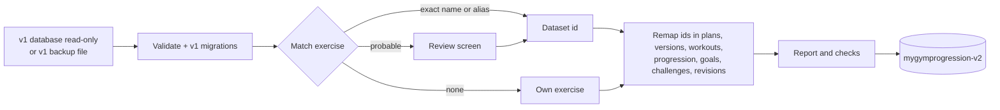

# MyGymProgression v2 — Plan

Status: **F0–F3 done (library; v1 migration with review and report); next F4 (new UI, variant A).** Branch `v2`. Started 2026-11-22.

Goal: a more professional app. New design, clearer organisation (shortcut icons, complete menus), features compared with openGym, exercise library from [exercises-dataset](https://github.com/hasaneyldrm/exercises-dataset), and all v1 data migrated without loss. **v1 is kept and can come back at any time.**

## 1. Decisions

| # | Decision | Date |
|---|---|---|
| V2-D1 | Same repository and same URL. v1 is frozen on branch `v1` and tag `v1-final` (c8ffedf; was 238d7ab before the history clean-up of 2026-11-22); the published v1 site build is tag `pages-v1-final` (4dfbc42, v0.1.30). v2 is developed on branch `v2` and published on the same URL only after acceptance. Rollback: `git checkout v1 && npm run deploy:pages`, or push `pages-v1-final` to `gh-pages`. | 2026-11-22 |
| V2-D2 | v2 has its own storage: IndexedDB `mygymprogression-v2`, localStorage keys with the prefix `v2:`. v2 reads the v1 database **read-only** (opened without a version, so no upgrade runs) and never writes to it. After a rollback, v1 finds its data as it was. | 2026-11-22 |
| V2-D3 | No export from v2 back to v1. Workouts logged in v2 stay in v2. | 2026-11-22 |
| V2-D4 | Exercise library: exercises-dataset. The data (MIT) is published with the app, pinned to one commit. Images and animations (© Gym visual) are **not** published with the app: after install, the user downloads them on the device from the source repository; they are then kept offline. The attribution "© Gym visual — gymvisual.com" shows only in the Exercises area. | 2026-11-22 |
| V2-D5 | Portuguese: own PT-PT translation, names first, then instructions; English is the fallback. Search works in both languages. openGym translations are AGPL and are not used. | 2026-11-22 |
| V2-D6 | New features: RIR/RPE per set, rest timer, plates and equipment, more set types, body (weight, measurements, photos), triple progression and deload, tools and structural balance. Not included: rotation schedule, starter plans. | 2026-11-22 |
| V2-D7 | v1 extras stay as they are (games, personal trainer, splash, retro easter egg, challenges, achievements), with the new design. | 2026-11-22 |
| V2-D8 | The design is chosen from a clickable HTML prototype with 2 variants, before implementation. | 2026-11-22 |
| V2-D9 | openGym (AGPL-3.0) gives ideas only. No code, text, translations or media are copied from it. | 2026-11-22 |
| V2-D10 | Design: variant **A · Grafite** of the prototype (neutral black and greys, one blue accent, grouped lists with hairlines, Inter with weights 400/600, tab bar Home · Plan · ▶ · Progress · Exercises, More as a grid of icons). Prototype: https://claude.ai/artifact/VdR97KYBPckrFkNURWrAwt | 2026-11-22 |
| V2-D11 | Home shortcuts: Free workout, Weight, Rest timer, Plates, 1RM, Backup by default; the user chooses and orders them in the app. | 2026-11-22 |
| V2-D13 | Migration rules (F3). (1) The v2 data model starts equal to v1; the fields of the new features (RIR, rest, set kinds, body…) are added in F5, optional and additive, so no migration is needed for them. (2) Exercises keep their v1 id; a v1 exercise linked to a library exercise takes its name (PT), muscles, equipment, images and source, and keeps its metrics, sets, progression, category, notes, favourite and own instructions; old names become other names. (3) Two v1 exercises linked to the same library exercise are joined (D19, `mergeExercises`); the review shows "Joins with". (4) Unused v1 library entries (e.g. the 3916 unused Exsercise.com entries) stay in v1 only; used, own, favourite or annotated exercises move. (5) Workout records and exercise snapshots do not change. (6) Import is allowed only when the report shows the same records, sets and volume, and no lost reference. | 2026-11-22 |
| V2-D14 | localStorage keys stay shared with v1 (deviation from V2-D2): they only hold per-device conveniences with the same meaning in both versions (gym name, closed cards, folded sections, game sound); no training data. | 2026-11-22 |
| V2-D15 | RIR in progression: a brake only. At the top of the range, when the last working set was to failure (RIR 0), the load does not go up this time. Nothing else changes. | 2026-11-22 |
| V2-D16 | Triple progression as a per-exercise option: all sets at the top of the range → +1 set (up to 2 above the plan); with the sets at the maximum and the top of the range → load up, back to the plan's sets and the range minimum. | 2026-11-22 |
| V2-D17 | Deload suggested on a stall: after "Stalled after" sessions without progress (setting, default 3), the app suggests −10 % load for that exercise; the user accepts or ignores it, like the other decisions. No planned deload weeks. | 2026-11-22 |
| V2-D18 | After the progression rules: PT-PT instructions for the 1324 exercises. | 2026-11-22 |
| V2-D12 | Exercise media URLs point to jsDelivr, pinned to dataset commit `7455efae41b330c265e7cd4b78dfa848e7ce5ebd` (CORS allowed, immutable cache). Images use `crossorigin="anonymous"` so cached responses are not opaque (opaque responses use about 7 MB of quota each in Chrome). | 2026-11-22 |

## 2. Findings that shaped the plan

- **Organisation (v1):** Exercises hidden in More; More has 6 large rows; actions of a plan or day are loose buttons; Home is one long column without shortcuts; the workout screen has 4 metrics with ± buttons and a cut chip row.
- **Design (v1):** weight 800 almost everywhere (no hierarchy), saturated indigo surfaces, outlined cards, text symbols (⬆ ＝ ⬇) as status, low density.
- **Service worker scope:** the v1 service worker controls all of `/MyGymProgression/`. A sub-folder for v2 would open v1. This is why V2-D1 replaces the site instead.
- **Migration test (backup 2026-11-22: 20 workouts, 2 plans, 25 plan versions, 189 progression events, 43 progression states; 50 exercises referenced):** 27 exact name matches, 20 probable matches to confirm, 3 without a match (Rowing, Jumping Jack, Elliptical Machine Walk). Some probable matches are wrong (Walking on Treadmill → stepmill instead of incline treadmill), so the review screen is required. Three pairs of v1 exercises map to one dataset exercise (two Leg Press 45°, two Leg Extensions, two Shoulder Presses): the migration must merge them.
- **Dataset vocabulary:** 19 target muscles and 40 secondary muscle names; v1 mapping missed `abs`, `pectorals`, `delts`, `quads`, `spine`, `hip flexors`, `core`, `rotator cuff`, `groin`, `inner thighs`, `shins`, `grip muscles`, `upper chest`. Names carry suffixes such as "(male)", "v. 2", "(on stability ball)".
- **Dataset:** 1324 exercises, 10 languages, no Portuguese. Thumbnails ~12 MB, animations ~127 MB.

## 3. Phases

| Phase | Output | Check |
|---|---|---|
| F0 | Branch `v1` + tags `v1-final`, `pages-v1-final`; branch `v2` | done |
| F1 | Clickable prototype, 2 variants: Home, Plan, Workout, Progress, Exercises, menus | user chooses |
| F2 | Library: import script, PT-PT names, muscle and equipment mapping, image download on the device | 1324 entries validated |
| F3 | Data model v2 + v1 importer with a review screen | user's backup: counts, sets and volume equal |
| F4 | New UI: design system, navigation, complete menus, shortcuts, extras restyled | e2e on phone and desktop |
| F5 | Features of V2-D6 | tests per feature |
| F6 | PT-PT instructions, final checks, publish on the same URL | user acceptance |

### F2 — Library (done 2026-11-22)

Result: `scripts/import_exercises_dataset.py` + `scripts/data/exercises-dataset-pt.tsv` (1324 PT-PT names, no duplicates) build `public/library/exercises-dataset.json` (1.4 MB, data only; types: 872 load, 364 reps only, 74 time, 14 distance). Settings installs it and downloads the media (`src/ui/media.ts`, cache `exercise-media`); the attribution shows in the Exercises list. Tests: 288 pass (`npm test`; `pool: 'vmThreads'` fixes the Vitest 5 / Node 26 start error that blocked every test since 2026-11-14). Browser check: install adds 1324 exercises; thumbnails and animations load with CORS. Left for later phases: PT-PT instructions (F6), browse by body map and equipment profile (F4/F5).

Original steps:

1. `scripts/import_exercises_dataset.py` builds `public/library/exercises-dataset.json` (data only, source ids = dataset ids, slugs `exds-<id>`).
2. Map dataset fields: target → primary muscles, secondary muscles, body part → group, equipment, instructions (en) → steps. Infer metrics (cardio → duration/distance; holds → duration) and load mode.
3. Map the 19 dataset target muscles to the 12 body-map muscles.
4. PT-PT names for all 1324 exercises; instructions in F6.
5. Exercises → "Download images" (thumbnails) and "Download animations": fetched from the pinned source commit, kept in Cache Storage. Animation of one exercise also loads on demand.

### F3 — Data model and migration (done 2026-11-22)

Result: `src/domain/migrate.ts` (suggestions, decisions, `migrateV1`, `checkMigration`), `src/data/v1source.ts` (reads the v1 database read-only; never creates or upgrades it), database `mygymprogression-v2` (`src/data/db.ts`), page `#/migrate` (`MigrationPage.tsx`: source → review → report → import), entry points on Home (no plan yet) and Settings. Matching: same words (with or without the equipment word) = exact; otherwise movement words 85 % + equipment ±15 %, "pec deck" read as "seated fly"; probable from 0.55. Tests: 296 pass (migration 5, v1 reader 3). Real backup 2026-11-22: 51 exercises (33 exact, 15 to confirm, 3 no match); report "everything matches" (2 plans, 25 versions, 43 states, 20 workouts, 189 events, 17 corrections, 38 game scores, 4 challenges, 3 trainer reports, 628 sets); browser check: import, Home and History correct; the v1 database is not created when absent and keeps its version when read.

Original notes:

New data: RIR/RPE per set and target RIR per prescription; rest time per item; set kinds (drop, rest-pause, failure, per side, pyramid); progression strategies linear and triple; deload; equipment profile (plates, bars, dumbbells, machine stacks); body weight, measurements, photos; module switches.

Rules:
- Keep each v1 id in `legacyIds` and the v1 name as an alias, so the import can run again without duplicates.
- Keep personal notes, favourites, own thumbnails, setup notes and workout snapshots.
- Checks before writing (one transaction): same number of plans, versions, workouts, sets and events; same total volume per workout; every reference resolves.
- Tests: synthetic v1 data in the repo; the user's real backup only locally (never committed).

### F4 — UI (in progress, 2026-11-22)

Done:
- F4.1 Design base (variant A): tokens for dark and light, system font, weights 400/500/600 only (70 heavier weights mapped to 600), no card borders or shadows, calmer buttons, blue accent `#2f6feb`; plan/day colours kept; the next-workout card is neutral with a 4 px plan-colour bar (same bar on day cards).
- F4.2 Navigation: tab bar Home · Plan · ▶ · Progress · Exercises (`App.tsx`). ▶ resumes the workout in progress, else opens the start sheet (next workout, every day of the active plans, free workout; nothing starts on one tap). "More" is a grid of icons (`NavSheets.tsx`) opened from the header of the main pages (`PageHead more`); the old `#/more` page shows the same grid. Progress = Reports | History (`ProgressSwitch`).
- F4.3 Home: header (date, greeting, search, More) and shortcuts grid (`Shortcuts.tsx`); the user turns shortcuts on/off and orders them (`Settings.shortcuts`, optional, in backups).
- F4.4 Menus: `ActionMenu` rows with icon and detail line (detail is the description, not the name); plan menu starts with Edit; every plan day has a ⋯ (start, edit, share as image, copy as text); exercise, finished workout and plan-editor menus have icons and Edit.

Left: F4.5 review of every page in both themes, e2e tests adapted to the new navigation; workout screen with the set table of the prototype comes with RIR and set kinds (F5).

Original notes:

- Navigation (proposal, final after F1): Home · Plan · ▶ Train (start or resume) · Progress (reports and history) · Exercises. A header icon opens More (Settings, Achievements, Challenges, Games, Personal trainer, About).
- Home: shortcut icons (start next, free workout, log weight, rest timer, plate calculator, backup).
- One complete ⋯ menu for each object: plan, day, plan item, workout, exercise in a workout, set, exercise.

### F5 — Features (in progress, 2026-11-22)

Done:
- F5.1 Effort and set kinds: RIR stored per set (RPE shown as 10 − RIR; Settings: RIR / RPE / off); target RIR per planned set (plan editor column); RIR chips coloured by effort on the open set; done sets show "· RIR 2". New set kinds `drop` and `restpause` (not counted for progression, like back-off sets). `src/domain/effort.ts`.
- F5.2 Rest timer: starts when a set is marked done (not after the last set), length from the plan item or Settings (default 90 s, or off); end time kept in the workout (survives a reload); compact bar with −15 s / +15 s / skip; sound and vibration at the end, closes 6 s later. `src/domain/rest.ts`, `RestBar.tsx`.
- F5.3 Plates: plates per side under the load of a bar exercise (barbell, EZ, trap bar), from the bars and plates in Settings; what the plates cannot make is shown. `src/domain/plates.ts`, `PlateLine.tsx`, `EquipmentEditor.tsx`.
- F5.4 Tools (`#/tools`): estimated 1RM (Epley; RIR counts as reps left), percentage table with reps at RIR 2, loads by reps and RIR, plate calculator. Shortcuts 1RM and Plates.
- F5.5 Body (`#/body`, Progress → Body): weigh-ins (unit of Settings, change over 30 days, weekly rate, goal line), measurements (latest per part with change), progress photos (JPEG ≤ 1080 px, kept in backups, before/after slider). Database v6, backup schema 18 (old schema-4 rest times are dropped on import, as in v1). Shortcut Weight.

Left: F5.6 triple progression and deload, and how RIR acts in progression (needs the user's decision); F5.7 structural balance and muscle recovery map; workout set table of the prototype.

## 4. Open points

- How RIR acts in the progression rules (only recorded and shown, or also blocks or speeds up an increase). Decide in F5.
- Exact home shortcuts and their order. Decide in F1.
